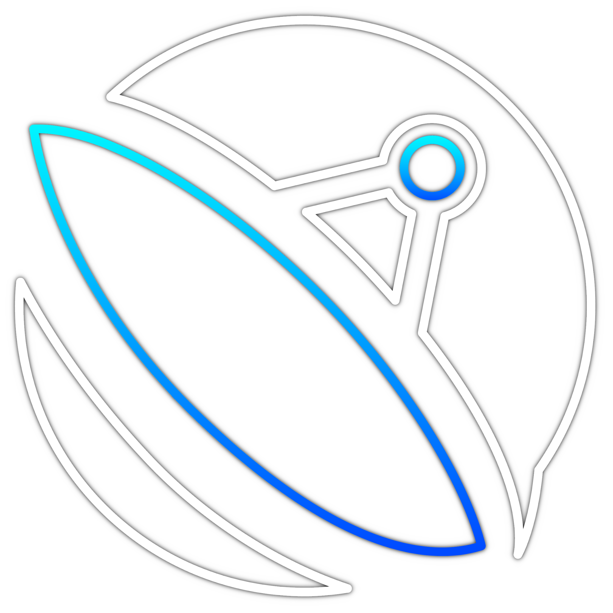
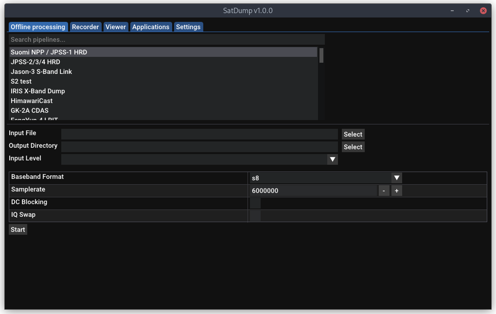
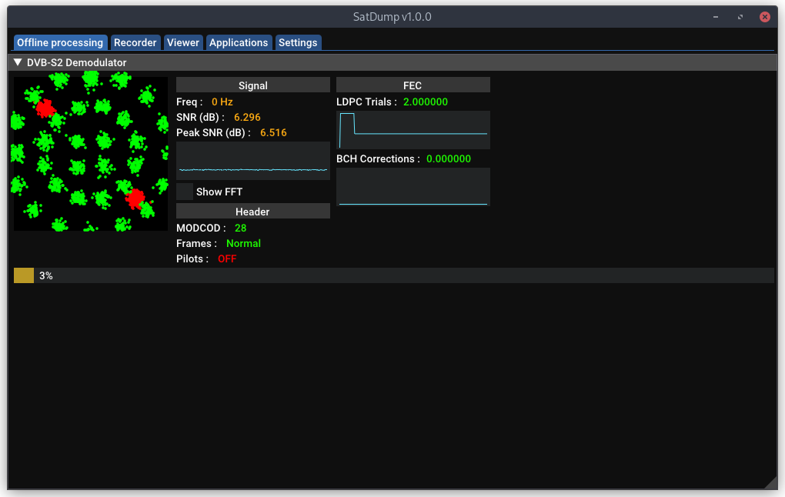
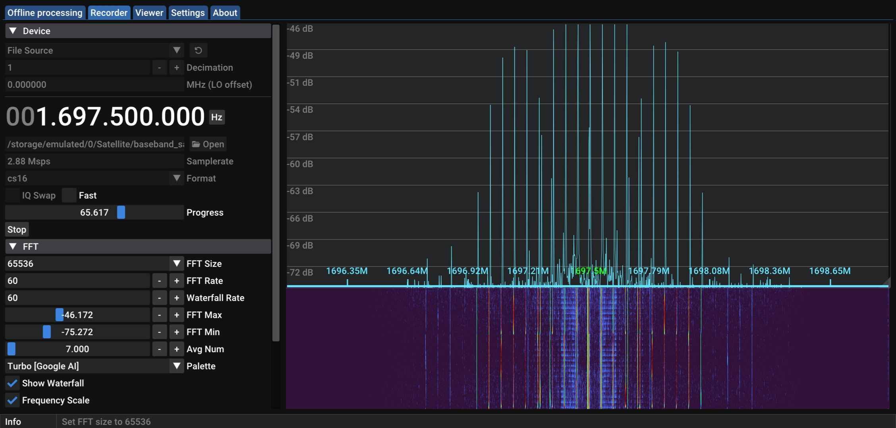
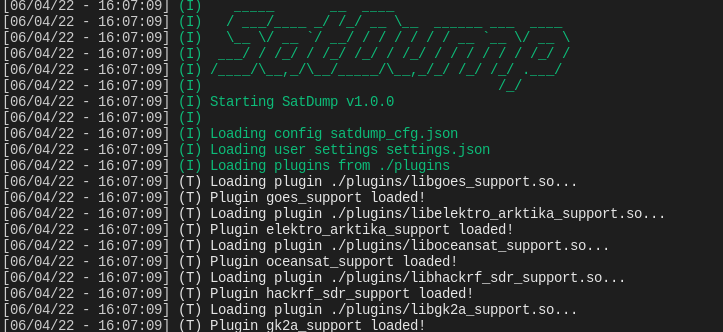

[English](README.md) | [简体中文](README_zh.md)

# SatDump
修改者:*MC_blone*


一款通用的卫星数据处理软件。
*感谢 Crosswalkersam 提供的图标！*

现在还有一个 [Matrix](https://matrix.to/#/#satdump:altillimity.com) 房间可以聊天！另外，还有一个连接到 Matrix 的 [Discord](https://discord.gg/ctt3M8pRYG) 桥接也可使用。

# 简介

*注意：这是一个非常基础的“如何操作”指南，省略了细节并假设您对所做操作有一定了解。更多详细信息及高级用例，请参阅[详细文档](https://docs.satdump.org)。*

## GUI 版本

### 离线处理（录制数据）
快速开始：
- 选择适合您要处理内容的处理流程（pipeline）
- 选择输入文件（基带、帧、软符号…）
- 设置适当的输入级别（您的文件类型）
- 检查下方显示的设置是否正确（例如采样率）
- 点击“开始”！




*SatDump 正在解调 DVB-S2 基带*

### 实时处理或录制（直接从 SDR）

快速开始：
- 进入“Recorder”（录制）选项卡
- 选择并启动您的 SDR 设备
- 选择处理流程
- 启动，完成！
- 如需录制，请使用录制选项卡。处理和录制可以同时使用。



## 命令行版本



### 离线处理

```bash
Usage : satdump [pipeline_id] [input_level] [input_file] [output_file_or_directory] [additional options as required]
Extra options (examples. Any parameter used in modules can be used here) :
  --samplerate [baseband_samplerate] --baseband_format [cf32/cs32/cs16/cs8/cu8] --dc_block --iq_swap
Sample command :
satdump metop_ahrpt baseband /home/user/metop_baseband.cs16 metop_output_directory --samplerate 6e6 --baseband_format cs16
```

您可以在[此处](https://docs.satdump.org/pipelines.html)找到卫星处理流程及其参数的列表。

### 实时处理

```bash
Usage : satdump live [pipeline_id] [output_file_or_directory] [additional options as required]
Extra options (examples. Any parameter used in modules or sources can be used here) :
  --samplerate [baseband_samplerate] --baseband_format [cf32/cs32/cs16/cs8/w8] --dc_block --iq_swap
  --source [airspy/rtlsdr/etc] --gain 20 --bias
As well as --timeout in seconds
Sample command :
satdump live metop_ahrpt metop_output_directory --source airspy --samplerate 6e6 --frequency 1701.3e6 --general_gain 18 --bias --timeout 780
```

您可以在[此处](https://docs.satdump.org/sdr_options.html)找到所有 SDR 选项的列表。运行 `satdump sdr_probe` 可获取可用 SDR 及其 ID 的列表。

### 录制

```bash
Usage : satdump record [output_baseband (without extension!)] [additional options as required]
Extra options (examples. Any parameter used in sources can be used here) :
  --samplerate [baseband_samplerate] --baseband_format [cf32/cs32/cs16/cs8/cu8/w16] --dc_block --iq_swap
  --source [airspy/rtlsdr/etc] --gain 20 --bias
As well as --timeout in seconds
Sample command :
satdump record baseband_name --source airspy --samplerate 6e6 --frequency 1701.3e6 --general_gain 18 --bias --timeout 780 --baseband_format cf32
```

# 构建 / 安装

### Windows
最快上手的方式是前往 [Releases](https://github.com/altillimity/SatDump/releases) 页面，在那里您可以下载 SatDump 的安装程序或便携版应用——无需编译。

我们的构建版本使用 Visual Studio 2019 针对 x64 构建，因此需要相应的 Visual C++ 运行库（不过很可能已经安装）。您可以在[此处](https://support.microsoft.com/en-us/topic/the-latest-supported-visual-c-downloads-2647da03-1eea-4433-9aff-95f26a218cc0)获取。下载后，运行 satdump-ui.exe 或 satdump.exe（命令行版）即可开始使用！

编译信息请参阅[此处](https://docs.satdump.org/build_windows.html)的专门文档。*注意：不支持 Mingw 构建，VOLK 无法工作。*

### macOS
[发布页面](https://github.com/altillimity/SatDump/releases)提供了无依赖的 macOS 构建（感谢 JVital2013，这些构建也已签名！）。

通用构建说明（需要 Brew 和 XCode 命令行工具）

```bash
# Install build tools
brew install cmake dylibbundler pkg-config libtool autoconf automake meson

# Clone SatDump
git clone https://github.com/SatDump/SatDump.git && cd SatDump

# Build dependencies
./macOS/Configure-vcpkg.sh

# Finally, build.
# If you do not want to build the GUI Version, add -DBUILD_GUI=OFF to the command
# If you want to disable some SDRs, you can add -DPLUGIN_HACKRF_SDR_SUPPORT=OFF or similar
mkdir build && cd build
cmake -DCMAKE_TOOLCHAIN_FILE=../vcpkg/scripts/buildsystems/vcpkg.cmake -DCMAKE_BUILD_TYPE=Release -DVCPKG_TARGET_TRIPLET=osx-satdump ..
make -j$(sysctl -n hw.logicalcpu)

# To run without bundling
ln -s ../pipelines .        # Symlink pipelines so it can run
ln -s ../resources .        # Symlink resources so it can run
ln -s ../satdump_cfg.json . # Symlink settings so it can run
./satdump-ui

# Make an app bundle (to add to your /Applications folder). Saves to build/MacApp, and
# a .dmg is created as well. 'make install' is not supported.
../macOS/bundle.sh
```

### Linux

在 Linux 上推荐从源码构建，但也为基于 x64 的 Ubuntu 发行版提供了构建。以下是常见发行版的构建说明。

---

<details>

<summary>安装依赖 - Debian、Ubuntu 及其他基于 Debian 的发行版</summary>

```bash
sudo apt install git build-essential cmake g++ pkgconf libfftw3-dev libpng-dev \
                 libtiff-dev libjemalloc-dev libcurl4-openssl-dev
sudo apt install libvolk-dev                                                      # If this package is not found, use libvolk2-dev or libvolk1-dev
sudo apt install libnng-dev                                                       # If this package is not found, follow build instructions below for NNG

# (Optional)
sudo apt install libglfw3-dev zenity                                              # Only if you want to build the GUI Version
sudo apt install portaudio19-dev                                                  # Only if you want audio output
sudo apt install libzstd-dev                                                      # Only if you want to build with ZIQ Recording compression
sudo apt install libhdf5-dev                                                      # Only if you want official product support (ex, EUMETSAT)
sudo apt install librtlsdr-dev libhackrf-dev libairspy-dev libairspyhf-dev        # All libraries required for live processing
sudo apt install libad9361-dev libiio-dev                                         # For ADALM-Pluto, PlutoPlus, AntSDR and other SDRs based on Analog AD9361
sudo apt install libbladerf-dev                                                   # For BladeRF
sudo apt install libomp-dev                                                       # Shouldn't be required in general, but in case you have errors with OMP
sudo apt install ocl-icd-opencl-dev                                               # Optional, but recommended as it drastically increases speed of some operations. Installs OpenCL.
sudo apt install intel-opencl-icd                                                 # Enables OpenCL for Intel Integrated Graphics
sudo apt install mesa-opencl-icd                                                  # For AMD Radeon cards *BEFORE series 5000* (e.g. RX480/580...). For newer cards, please install the official AMD drivers.

# One-liner to install all dependencies:
sudo apt install git build-essential cmake g++ pkgconf libfftw3-dev libpng-dev \
                 libtiff-dev libjemalloc-dev libcurl4-openssl-dev libvolk-dev libnng-dev \
                 libglfw3-dev zenity portaudio19-dev libzstd-dev libhdf5-dev librtlsdr-dev \
                 libhackrf-dev libairspy-dev libairspyhf-dev libad9361-dev libiio-dev \
                 libbladerf-dev libomp-dev ocl-icd-opencl-dev intel-opencl-icd mesa-opencl-icd
```

</details>
<details>

<summary>安装依赖 - 基于 Red-Hat 的系统</summary>

```bash
sudo dnf install git cmake g++ fftw-devel volk-devel libpng-devel jemalloc-devel \
                 libtiff-devel nng-devel curl-devel

# (Optional)
sudo dnf install glfw-devel zenity                                                # Only if you want to build the GUI Version
sudo dnf install portaudio-devel                                                  # Only if you want audio output
sudo dnf install libzstd-devel                                                    # Only if you want to build with ZIQ Recording compression
sudo dnf install hdf5-devel                                                       # Only if you want official product support (ex, EUMETSAT)
sudo dnf install rtl-sdr-devel hackrf-devel airspyone_host-devel                  # All libraries required for live processing
sudo dnf install libomp-devel                                                     # Shouldn't be required in general, but in case you have errors with OMP
sudo dnf install ocl-icd                                                          # Optional, but recommended as it drastically increases speed of some operations. Installs OpenCL.
sudo dnf install intel-opencl                                                     # Enables OpenCL for Intel Integrated Graphics

# One-liner to install all dependencies:
sudo dnf install git cmake g++ fftw-devel volk-devel libpng-devel jemalloc-devel hdf5-devel \
                 libtiff-devel nng-devel curl-devel glfw-devel zenity portaudio-devel \
                 libzstd-devel rtl-sdr-devel hackrf-devel airspyone_host-devel libomp-devel \
                 ocl-icd intel-opencl
```
</details>
<details>

<summary>安装依赖 - 基于 Alpine 的系统</summary>

```bash
# Adding the testing repository is required for libvolk-dev.
# You need to build libnng from source, see below.
sudo apk add git cmake make g++ pkgconf fftw-dev libvolk-dev libpng-dev \
             jemalloc-dev tiff-dev curl-dev

# (Optional)
sudo apk add glfw-dev zenity                                           # Only if you want to build the GUI Version
sudo apk add portaudio-dev                                             # Only if you want audio output
sudo apk add zstd-dev                                                  # Only if you want to build with ZIQ Recording compression
sudo apk add hdf5-dev                                                  # Only if you want official product support (ex, EUMETSAT)
sudo apk add librtlsdr-dev hackrf-dev airspyone-host-dev airspyhf-dev  # All libraries required for live processing
sudo apk add opencl-dev                                                # Optional, but recommended as it drastically increases speed of some operations. Installs OpenCL. Community repo required.
```
</details>
<details>

<summary>安装依赖 - Gentoo</summary>

```bash
# Assumes you already have gcc, g++, pkgconf, and cmake installed. 
# Using Gentoo, you probably do!
#
# NOTE: You will need to build nng yourself. See below for details.
#       Some SDR sources, such as AirSpy, also need to be build from
#       source if needed.

sudo emerge --ask dev-vcs/git sci-libs/fftw dev-libs/jemalloc sci-libs/volk \
                  media-libs/libpng media-libs/tiff net-misc/curl

sudo emerge --ask media-libs/glfw gnome-extra/zenity      # Only if you want to build the GUI Version
sudo emerge --ask media-libs/portaudio                    # Only if you want audio output
sudo emerge --ask app-arch/zstd                           # Only if you want to build with ZIQ Recording compression
sudo emerge --ask sci-libs/hdf5                           # Only if you want official product support (ex, EUMETSAT)
sudo emerge --ask net-wireless/rtl-sdr                    # RTL-SDR Support
sudo emerge --ask net-libs/libhackrf                      # HackRF Support
sudo emerge --ask net-wireless/bladerf                    # bladeRF Support
sudo emerge --ask net-libs/libiio net-libs/libad9361-iio  # For ADALM-Pluto, PlutoPlus, AntSDR and other SDRs based on Analog AD9361
sudo emerge --ask dev-libs/opencl-icd-loader              # OpenCL Support, Optional, but recommended

# One-liner to install all dependencies:
sudo emerge --ask dev-vcs/git sci-libs/fftw dev-libs/jemalloc sci-libs/volk \
                  media-libs/libpng media-libs/tiff net-misc/curl sci-libs/hdf5 \
                  media-libs/glfw gnome-extra/zenity media-libs/portaudio \
                  app-arch/zstd net-wireless/rtl-sdr net-libs/libhackrf   \
                  net-wireless/bladerf net-libs/libiio net-libs/libad9361-iio \
                  dev-libs/opencl-icd-loader
```

</details>
<details>

<summary>安装依赖 - openSUSE</summary>

```bash
sudo zypper install git gcc-c++ cmake g++ pkgconf fftw3-devel libpng-devel \
                    libtiff-devel jemalloc-devel libcurl-devel volk-devel  \
                    nng-devel 

# (Optional)
sudo zypper install libglfw-devel zenity                                        # Only if you want to build the GUI Version
sudo zypper install portaudio-devel                                             # Only if you want audio output
sudo zypper install libzstd-devel                                               # Only if you want to build with ZIQ Recording compression
sudo zypper install hdf5-devel                                                  # Only if you want official product support (ex, EUMETSAT)
sudo zypper install rtl-sdr-devel hackrf-devel airspy-devel airspyhf-devel      # All libraries required for live processing
sudo zypper install libad9361-iio-devel libiio-devel                            # For ADALM-Pluto, PlutoPlus, AntSDR and other SDRs based on Analog AD9361
sudo zypper install bladeRF-devel                                               # For BladeRF
sudo zypper install libomp-devel                                                # Shouldn't be required in general, but in case you have errors with OMP
sudo zypper install opencl-headers libOpenCL1                                   # Optional, but recommended as it drastically increases speed of some operations. Installs OpenCL.
sudo zypper install intel-opencl                                                # Enables OpenCL for Intel Integrated Graphics
sudo zypper install Mesa-libOpenCL                                              # For AMD Radeon cards *BEFORE series 5000* (e.g. RX480/580...). For newer cards, please install the official AMD drivers.

# One-liner to install all dependencies:
sudo zypper install git gcc-c++ cmake g++ pkgconf fftw3-devel libpng-devel libtiff-devel jemalloc-devel \
                    libcurl-devel hdf5-devel volk-devel nng-devel libglfw-devel zenity portaudio-devel \
                    libzstd-devel rtl-sdr-devel hackrf-devel airspy-devel airspyhf-devel libad9361-iio-devel \
                    libiio-devel bladeRF-devel libomp-devel opencl-headers libOpenCL1 intel-opencl Mesa-libOpenCL

```

</details>

---

如果您的发行版没有提供 nng，则需要从源码构建它
```bash
git clone https://github.com/nanomsg/nng.git -b v1.9.0
cd nng
mkdir build && cd build
cmake -DCMAKE_BUILD_TYPE=Release -DBUILD_SHARED_LIBS=ON -DCMAKE_INSTALL_PREFIX=/usr ..
make -j4
sudo make install
cd ../..
rm -rf nng
```

#### 构建 SatDump
```bash
git clone https://github.com/SatDump/SatDump.git
cd SatDump
mkdir build && cd build
# If you do not want to build the GUI Version, add -DBUILD_GUI=OFF to the command
# If you want to disable some SDRs, you can add -DPLUGIN_HACKRF_SDR_SUPPORT=OFF or similar
cmake -DCMAKE_BUILD_TYPE=Release -DCMAKE_INSTALL_PREFIX=/usr ..
make -j`nproc`

# To run without installing
ln -s ../pipelines .        # Symlink pipelines so it can run
ln -s ../resources .        # Symlink resources so it can run
ln -s ../satdump_cfg.json . # Symlink settings so it can run

# To install system-wide
sudo make install

# Run (if you want!)
./satdump-ui
```

### 树莓派

如果您使用的是 RPi3（任意版本）及更旧型号，请运行 `make -j1` 而不是 `make -j\`nproc\``，否则系统会崩溃。
  
### Android

在 Android 上，推荐的首选来源是 F-Droid。

[](https://f-droid.org/packages/org.satdump.SatDump)

如果这对您来说不是可行方案，[Release](https://github.com/altillimity/SatDump/releases) 页面也提供 APK。

请记住，虽然几乎所有的功能在 Android 上都能完美运行，但在某些地方可能会受到限制（可能是由于硬件原因）。例如，并非所有 SDR 设备都可以使用。
支持的 SDR 设备包括：
- RTL-SDR
- Airspy
- AirspyHF
- LimeSDR Mini
- HackRF

### Docker

在 Docker 中构建和运行是隔离构建环境、库与主机操作系统的一个好方法。
构建过程采用多阶段构建，使用两个镜像：一个包含 -dev 包，另一个用于运行时。
这意味着运行时镜像可以保持较小，尽管完成构建仍需要占用磁盘空间。

为了让共享文件的属主与系统用户匹配，请在构建镜像前在 `.env` 中设置这些值。
容器内的用户始终命名为 `satdump`，但 uid 和 gid 将与系统用户匹配。

```bash
# set the current uid and gid 
printf "HOST_UID: $(id -u)\nHOST_GID: $(id -g)\n" > .env

# create the shared directory
mkdir -p srv

# Build the images with compose, 8 parallel
docker compose build --build-arg CMAKE_BUILD_PARALLEL_LEVEL=8

# Launch a shell inside the container/service
docker compose run --rm -it satdump
```

容器内启动的命令可以在上述命令行的末尾指定，
也可以在 `.env` 中设置，例如 `COMMAND: satdump_sdr_server`。如果您想在后台运行 sdr 服务器并在开机时自动启动，只需使用 `docker compose up -d` 启动容器，并用
`docker compose logs -f` 查看日志。

#### Docker 下的 X11

要在 Docker 下使用 `satdump-ui`，需要进行一些改动。
也可以在 WSL2 上运行，此时将源改为 `/run/desktop/mnt/host/wslg/.X11-unix`。
在 [docker-compose.yml](docker-compose.yml) 中，您需要取消注释几行，使其如下所示：
```yaml
      - type: 'bind'
        source: '/tmp/.X11-unix'
        target: '/tmp/.X11-unix'
```

如果容器内的用户没有 X11 授权，您可能会看到如下错误信息：
`Authorization required, ...`
这是由于控制屏幕访问权限的 ACL 所致。
有几种方法可以解决这个问题，有些方法非常宽松且不安全，但以下方法在非共享系统上应该是可以接受的。

在主机上运行：`xhost +local:docker`，然后启动 UI：`docker compose run --rm -it satdump satdump-ui`